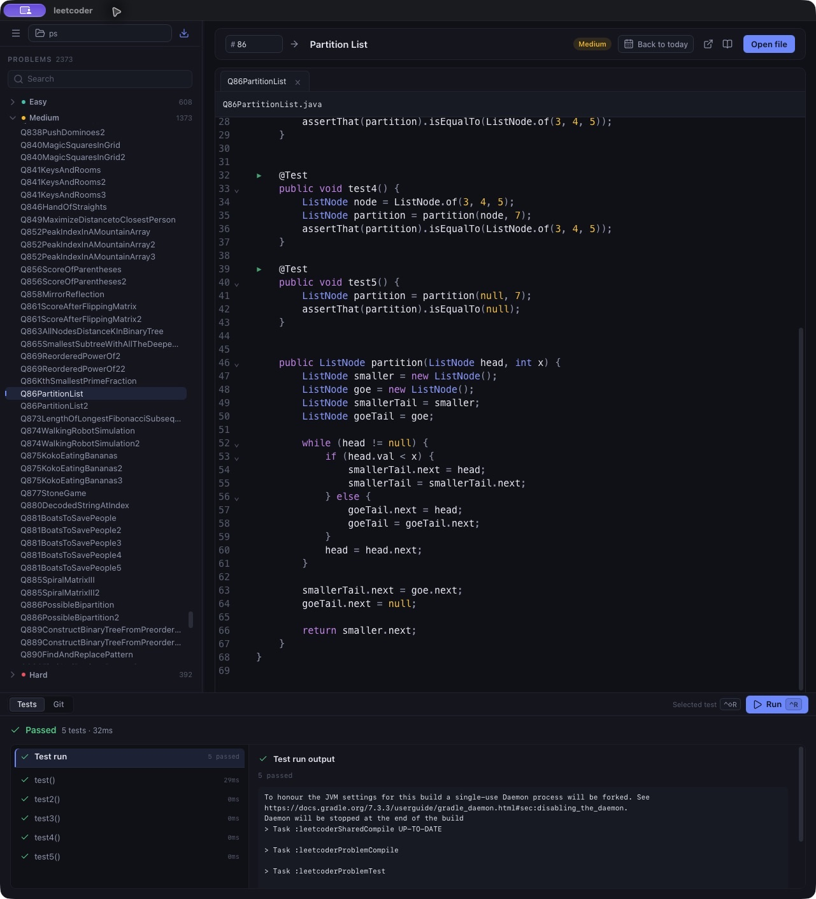

# leetcoder

A focused Tauri desktop editor for Java solutions in the `ps` repository:
browse problems, edit solutions with Java-aware assistance, run JUnit tests,
and review and commit changes.
The app supports that repository's layout rather than arbitrary Java projects.

<p align="center">
  
  <br />
  
</p>

See [architecture and work ownership](docs/architecture.md) for module boundaries,
[the performance audit](docs/performance.md) for measured results and caveats,
and [AGENTS.md](AGENTS.md) for contribution policy.

## Features

- **Problem browsing:** load today's daily problem or look up a problem by
  number, read its description in the app, and create or reopen its Java file.
- **Workspace:** browse problems by difficulty, filter filenames, and search
  saved project contents. Open solutions in tabs with autosave and external
  file change detection. Duplicate a solution for another attempt while
  retaining its test harness and fixtures, or rename, delete, and reveal files.
- **Java assistance:** complete local symbols, members, common collection APIs,
  supported Stream chains and Collectors recipes, and public library APIs from
  the repository classpath. Parameter hints show overloads and the current
  argument. `Ps` helper completions reflect resolved dependencies and refresh
  after Gradle changes.
- **Editing tools:** expand live templates such as `test`, `iter`, `mod`,
  `sout`/`soutv`, and `serr`/`serrv`, with linked editable fields and inferred
  names or types. Use automatic imports, unused-import cleanup, formatting,
  JavaDoc generation, string-aware paste, and statement completion. Navigate to
  same-file definitions, highlight same-file usages, and rename local variables,
  parameters, or methods. Introduce variables, extract methods, and inline
  supported fields or local variables, including local array initializers.
  Apply supported intentions such as creating a missing helper or adding a
  missing parameter when the required types can be inferred safely.
- **Tests and diagnostics:** run a class or one test from the cursor or gutter,
  follow compilation and execution progress, stop a run, and inspect individual
  test output and failures. Compiler diagnostics also appear while editing.
- **Git:** inspect the branch, changed files, and diffs; select files to
  **Commit** or **Commit & Push**, or confirm a discard. The Git tab indicates
  uncommitted or unpushed changes.
- **App controls:** choose System, Light, or Dark appearance, resize panes, and
  adjust the editor font size. Theme, layout, and font preferences persist.
  **Settings → Keyboard shortcuts** lists bindings for macOS and Linux from
  [the shared shortcut definitions](src/shortcuts.ts).

## Requirements

Use Rust stable through [rustup](https://rustup.rs/) and Node.js 22 LTS
(Vite 7 requires Node 20.19+ or 22.12+). On macOS, install Xcode Command Line
Tools with `xcode-select --install`. Ubuntu 24.04 needs the Tauri 2 prerequisites
used by CI:

```bash
sudo apt-get update
sudo apt-get install -y \
  build-essential curl wget file libssl-dev libxdo-dev \
  libayatana-appindicator3-dev librsvg2-dev libwebkit2gtk-4.1-dev
```

The native build requires WebKitGTK 4.1; the older 4.0 package is not a
substitute. The Tauri CLI is local to the project; `npm ci` installs it.

The selected `ps` repository uses Java 11 source/target compatibility and
Gradle **7.3.3**. The app prefers JDK 17 and falls back to JDK 11; newer JDKs
such as JDK 25 are outside that wrapper's supported range. Check in the
selected repository:

```bash
java -version
./gradlew --version
```

For multiple macOS JDKs, select the environment before launching from that shell:

```bash
export JAVA_HOME=$(/usr/libexec/java_home -v 17)
export PATH="$JAVA_HOME/bin:$PATH"
```

Use the JDK 11 installation if 17 is unavailable. The desktop app inherits
its launch environment and also discovers the highest supported installed JDK
up to 17.

## Install, run, and build

From this repository root:

```bash
npm ci
npm run tauri -- dev
```

`npm ci` uses the committed lockfile. The Tauri development command starts
Vite and the desktop window together. `npm run dev` starts a browser-only
frontend; native folder picking, file access, and Gradle execution require Tauri.

Frontend checks are:

```bash
npm run typecheck
npm test -- --maxWorkers=1
npm run build
```

Run disposable Rust checks in a temporary target, with incremental compilation
disabled; remove it afterward. The development profile retains this crate's
line tables and omits dependency debug information. Use `--profile debugging`
when full debug information is needed.

```bash
(
  export CARGO_TARGET_DIR="$(mktemp -d /tmp/leetcoder-check.XXXXXX)"
  export CARGO_INCREMENTAL=0 CARGO_BUILD_JOBS=1
  trap 'rm -rf "$CARGO_TARGET_DIR"' EXIT
  cargo fmt --manifest-path src-tauri/Cargo.toml --all -- --check
  cargo test --manifest-path src-tauri/Cargo.toml -- --test-threads=1
  cargo check --manifest-path src-tauri/Cargo.toml
)
```

`npm run tauri -- build` creates an unsigned native bundle under
`src-tauri/target/release/bundle/`. It does not install, sign, or publish a release.
To build, atomically install, and restart the application used by the desktop
launcher, run:

```bash
npm run rebuild
```

This replaces `/Applications/leetcoder.app` on macOS, or installs an AppImage
and desktop entry under the Linux user's `~/.local` directories. The build and
launch log is `leetcoder-rebuild.log` in the system temporary directory.
A frontend build alone does not update the installed app. Production rebuilds
intentionally use the persistent `src-tauri/target` path; preserve it for this
workflow.

The in-app **Update leetcoder** action also rebuilds, installs, and restarts
from the existing local source checkout when its commit differs from the
installed build. It requires a clean working tree and the build tools above;
it does not fetch or pull remote changes or download a published release.

## Daily workflow

1. Choose the `ps` root containing `build.gradle`, `settings.gradle`, and
   `gradlew`. The app validates
   `src/main/java/shane/leetcode/problems/{easy,medium,xhard}` and remembers
   the selected path locally.
2. Load today's problem or enter a problem number in the header. Read its
   description in the app, open the problem in a browser, or use **Back to
   today** after browsing another problem.
3. Select **Create file**, or **Open file** if a Java solution already exists.
   When several attempts exist, the app opens the highest numbered Java
   variant. Easy maps to `shane.leetcode.problems.easy`, Medium to `.medium`,
   and Hard to `.xhard`. Generated names follow the repository's
   `ClassNameFactory` convention, using an available numeric suffix to avoid
   collisions with Java or Kotlin files.
4. Edit the solution in a tab. Changes autosave after a short pause and are
   flushed before navigation, tests, and Git operations; a manual save action
   is also available. Clean documents reload external changes, while unsaved
   edits are preserved. Use the file context menu's **Duplicate** action to
   start another attempt with the existing tests.
5. Use **Run** for the class, or run the test at the cursor or from its gutter
   marker. Inspect progress, individual results, compiler errors, and stdout
   or stderr in **Tests**; use **Stop** to cancel a running test.
6. Open **Git** to inspect diffs and choose the files to commit. Enter a commit
   message, then choose **Commit** or **Commit & Push**. Pushing uses the
   repository's configured upstream and existing Git credentials.

When macOS blocks access to the selected repository folder, the app offers
**Choose folder again** and **Open permission settings** to help restore access.

### Generated scaffold and test execution

The first method signature from a Java snippet is inserted without its body,
alongside JUnit and AssertJ imports:

```java
package shane.leetcode.problems.easy;

import org.junit.jupiter.api.Test;
import static org.assertj.core.api.Assertions.assertThat;

public class Q3622CheckDivisibilityByDigitSumAndProduct {
    @Test
    public void test() {
        assertThat()
    }

    public boolean checkDivisibility(int n) {

    }
}
```

The scaffold intentionally does not compile until you fill in the assertion
and solution. A missing or unparseable Java snippet creates the class, imports,
and `@Test` method; add the solution method yourself.

Problem tests live alongside solutions in `src/main/java`. Each run creates a
temporary Gradle init script rather than modifying `build.gradle` or installing
a permanent task. It compiles the selected problem and shared Java sources
outside the problem folders, then runs JUnit Platform with the test runtime
JARs and main resources. Other problem files do not need to compile for the
selected problem to run.

Compiled shared and problem classes are cached under the selected repository's
`build/leetcoder/v1/` directory. The temporary init script is removed afterward.
Test execution has a five-second limit, excluding compilation. Execution still
depends on the repository's wrapper, downloaded dependencies, and supported JDK.

## CI and limitations

[The CI workflow](.github/workflows/leetcoder.yml) runs on pushes and pull
requests to `main`, or manually with `workflow_dispatch`. Its macOS/Ubuntu
matrix runs frontend typecheck/test/build, Rust format/test/check, and the
native bundle build; Ubuntu first installs the dependencies above. Bundles
are uploaded as workflow artifacts, without signing or publishing releases.

The app has no login, submission, or guaranteed offline cache. Problem requests
use an unauthenticated endpoint that may change or reject requests. Project
content search reads saved files; it does not search unsaved editor buffers.
Java assistance uses lightweight analysis and available classpath metadata;
refactorings and intentions apply only when their supported patterns can be
resolved safely. There is no Java language server, debugger, or project-wide
rename. Repository layout and local Gradle/JDK requirements remain part of the
supported workflow.
