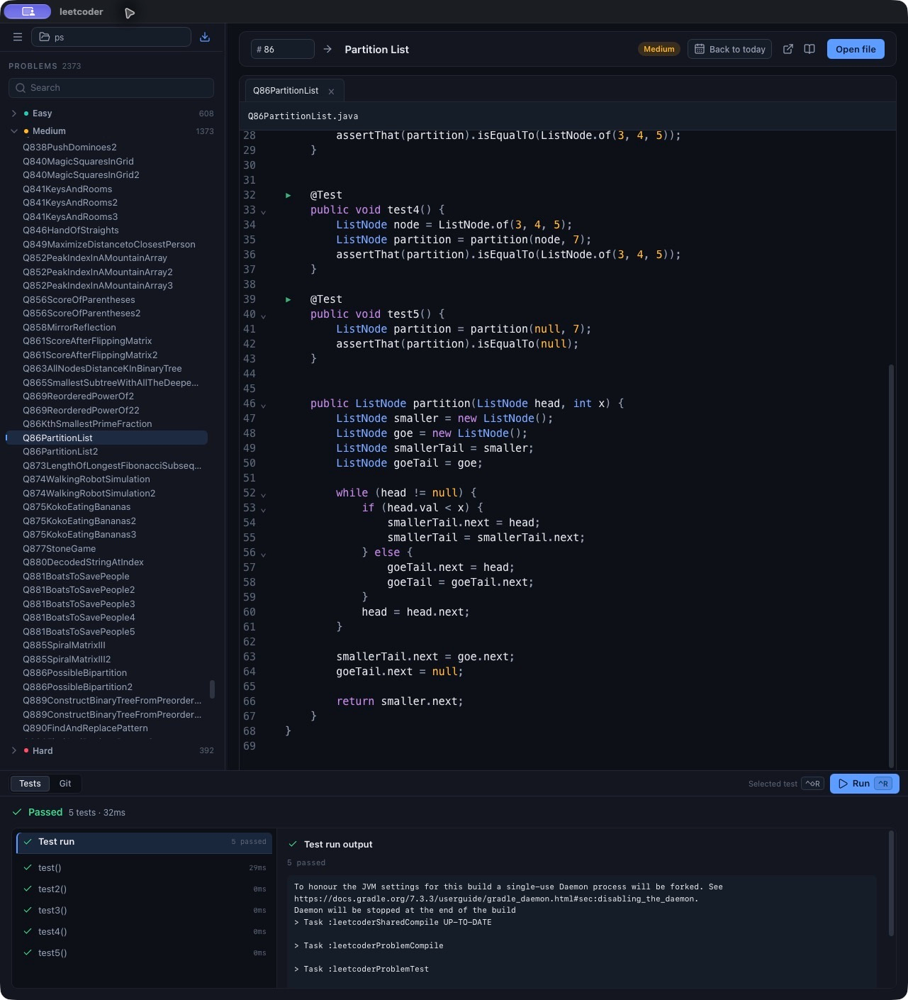

<h1> leetcoder</h1>

A desktop editor for solving Java problems in the `ps` repository: browse problems,
edit solutions, run JUnit tests, and review and commit changes.

## Features

- **Problems and workspace:** open the daily problem or look up a problem by
  number, read its description, and create a solution. Browse by difficulty,
  search files and saved contents, and duplicate, rename, or delete solutions.
- **Java assistance:** complete local symbols, members, collections, supported
  Stream chains, and classpath library APIs, with overload and parameter hints.
- **Editing:** use live templates, automatic imports, formatting, JavaDoc,
  same-file navigation and usage highlighting, and supported renaming,
  variable/method extraction, inlining, and intentions.
- **Tests:** run a class or individual test, follow progress, stop execution,
  and inspect results and output. Compiler diagnostics also appear while editing.
- **Git:** review changes and diffs, select files, and commit or commit and push.
- **Workspace preferences:** autosave, tabs, external file change detection,
  resizable panes, theme and font settings, and a keyboard shortcut list backed
  by [the shared definitions](src/shortcuts.ts).

<p align="center">
  
</p>

## Install, run, and build

Build from this repository's source using the instructions for your OS.

### macOS

Install [Node.js 22 LTS](https://nodejs.org/),
[Rust stable through rustup](https://rustup.rs/), and JDK 17.
Install Xcode Command Line Tools:

```bash
xcode-select --install
```

From a checkout of this repository, run:

```bash
npm ci
npm run rebuild
```

This builds, installs, and launches `/Applications/leetcoder.app`, which you can
keep in the Dock. To update after changing or pulling source, run `npm run rebuild`
again.

### Ubuntu 24.04

Install [Node.js 22 LTS](https://nodejs.org/) and
[Rust stable through rustup](https://rustup.rs/), then install JDK 17 and the
native build dependencies:

```bash
sudo apt-get update
sudo apt-get install -y \
  openjdk-17-jdk build-essential curl wget file libssl-dev libxdo-dev \
  libayatana-appindicator3-dev librsvg2-dev libwebkit2gtk-4.1-dev
```

From a checkout of this repository, run:

```bash
npm ci
npm run rebuild
```

This builds, installs, and launches `~/.local/lib/leetcoder/leetcoder.AppImage`.
The launcher is installed at `~/.local/share/applications/leetcoder.desktop`.
To update after changing or pulling source, run `npm run rebuild` again.

## Use

Choose a `ps` repository containing `build.gradle`, `settings.gradle`, `gradlew`,
and `src/main/java/shane/leetcode/problems/{easy,medium,xhard}`. The supported setup
uses Java 11 source/target compatibility and Gradle 7.3.3; the app prefers JDK 17 and
falls back to JDK 11.

1. Open today's problem or look up a problem number, then choose **Create file**
   or **Open file**.
2. Edit your solution; changes save automatically. Use **Duplicate** to start
   another attempt with the same test harness.
3. Run the class or an individual test and inspect results in **Tests**.
4. Review diffs in **Git**, select files, and choose **Commit** or **Commit & Push**.

## Development

Run the desktop app in development mode from the repository root:

```bash
npm ci
npm run tauri -- dev
```

See [AGENTS.md](AGENTS.md) for contribution and verification instructions, and
[architecture and work ownership](docs/architecture.md) for module boundaries.
