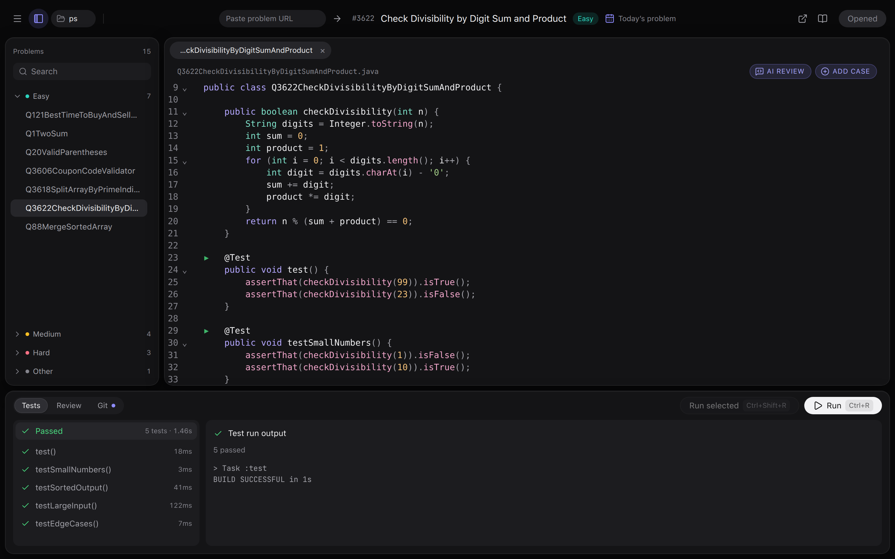
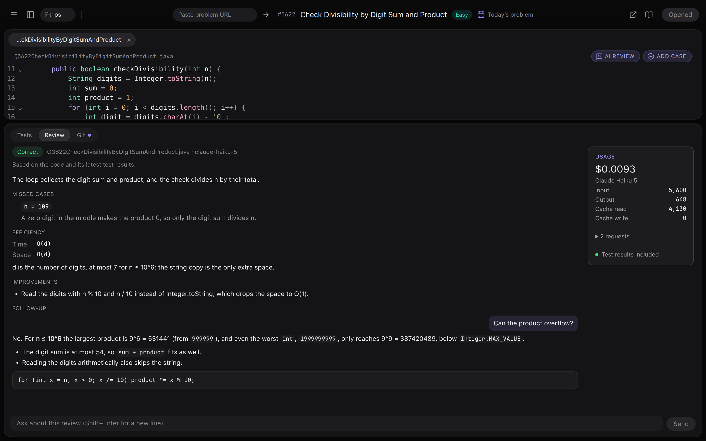
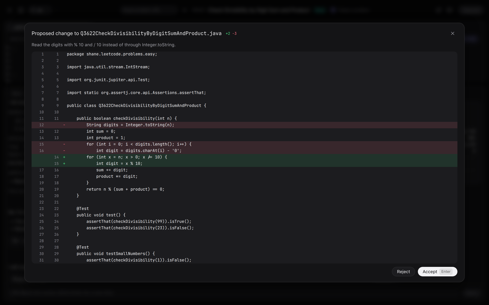

<h1> leetcoder</h1>

A desktop editor for solving Java problems in the `ps` repository: browse problems,
edit solutions, run JUnit tests, and review and commit changes.

<p align="center">
  
</p>

## Why leetcoder

You write the solution yourself; the app takes care of everything around it.

- **You solve, AI reviews.** The AI never writes your solution on its own. When
  you are done, **AI review** checks correctness, edge cases, and complexity
  against your test run, and you can ask follow-up questions. It changes code
  only when you ask, as a diff you accept or reject.
- **The chores are automated.** Today's problem arrives with its description and
  a ready-to-run solution file, **Fill test** turns the examples into JUnit
  assertions, and **Add case** turns a failing case into a new test.
- **A real editor, not a browser text box.** Java completion and refactors,
  one-key test runs, and commit and push to your solutions repository, in one
  window.

<p align="center">
  
  
</p>

## Features

- **Problems and workspace:** open the daily problem or paste a problem's URL,
  read its description, and create a solution; the daily card shows a disabled
  **Opened** button while that file is open. Browse by difficulty,
  search files and saved contents, and duplicate, rename, or delete solutions.
- **Java assistance:** complete local symbols, members, field chains through
  classes in the same file, collections, supported Stream chains, and classpath
  library APIs, with overload and parameter hints.
- **Editing:** use live templates, automatic imports, formatting that keeps the
  cursor in place, JavaDoc, find in file, a jump to the next compiler error,
  same-file navigation and usage highlighting, and supported renaming,
  variable/method extraction, inlining, and intentions such as creating a method
  on a class in the same file or adding a parameter and updating its calls.
- **Tests:** run the class with **Run** or the test at the cursor with
  **Run selected**, follow progress, stop execution, and inspect results and
  output. A verdict line tops the test list, and a draggable split separates the
  list from the output. Compiler diagnostics also appear while editing.
- **AI tests:** with a Claude API key, **Fill test** writes the examples into a
  bare `test()`, and **Add case** turns a pasted failing case, time-limit
  result, or described stress case into the next `testN()` method.
- **AI review:** **AI review** reviews the open solution with a model you choose,
  including the last test run when the code is unchanged, and streams the result
  into the **Review** tab in English or Korean. Ask follow-up questions there; the
  answers stream in as Markdown from the review model. Only when you explicitly ask
  for a change, such as a fix, does the AI propose one: a whole-file change that
  opens as a unified diff with **Accept** (Enter) and **Reject**. Accept applies it as
  one undoable edit and is blocked if the editor changed since. A live meter shows
  tokens and cost for the review and its follow-ups; output tokens and cost are
  estimates (≈) until each answer finishes.
- **Git:** review changes and diffs, select files, discard selected changes, and
  commit or commit and push after a confirmation where Enter confirms and Esc
  cancels. Commit & Push fast-forwards from the upstream first and stops before
  committing when the branch cannot fast-forward.
- **Workspace preferences:** autosave, tabs, external file change detection,
  resizable panes, theme and font settings, and a keyboard shortcut list backed
  by [the shared definitions](src/shortcuts.ts). Shortcuts use Alt on Linux and
  ⌘ on macOS, such as Alt+F and ⌘F for find in file; F2 jumps to the next error.
  Workspace shortcuts show or hide Problems, Tests, and Git and start a commit,
  and holding the modifier shows their keytips.

## Install, run, and build

Build from this repository's source using the instructions for your OS.
`npm run rebuild` prints the path of its log when it finishes or fails.

### macOS

Install [Node.js 22 LTS](https://nodejs.org/),
[Rust stable through rustup](https://rustup.rs/), and JDK 17.
Install Xcode Command Line Tools:

```bash
xcode-select --install
```

From a checkout of this repository, run:

```bash
npm run rebuild
```

This installs the locked npm dependencies, then builds, installs, and launches
`/Applications/leetcoder.app`, which you can keep in the Dock. To update after changing or pulling source, run `npm run rebuild`
again.

### Ubuntu 24.04

Install [Node.js 22 LTS](https://nodejs.org/) and
[Rust stable through rustup](https://rustup.rs/), then install JDK 17 and the
native build dependencies:

```bash
sudo apt-get update
sudo apt-get install -y \
  openjdk-17-jdk build-essential curl wget file libssl-dev libxdo-dev \
  libayatana-appindicator3-dev librsvg2-dev libwebkit2gtk-4.1-dev
```

From a checkout of this repository, run:

```bash
npm run rebuild
```

This installs the locked npm dependencies, then builds, installs, and launches
`~/.local/lib/leetcoder/leetcoder.AppImage`.
The launcher is installed at `~/.local/share/applications/leetcoder.desktop`.
To update after changing or pulling source, run `npm run rebuild` again.

## Use

Choose a `ps` repository containing `build.gradle`, `settings.gradle`, `gradlew`,
and `src/main/java/shane/leetcode/problems/{easy,medium,xhard}`. The supported setup
uses Java 11 source/target compatibility and Gradle 7.3.3; the app prefers JDK 17 and
falls back to JDK 11.

1. Open today's problem or paste a problem's URL, then choose **Create file** or
   **Open file**.
2. Edit your solution; changes save automatically. Use **Duplicate** to start
   another attempt with the same test harness.
3. Run the class or an individual test and inspect results in **Tests**.
4. Optionally choose **AI review** and ask follow-up questions in **Review**.
   Add a Claude API key in the LLM settings first.
5. Review diffs in **Git**, select files, choose **Commit** or **Commit & Push**,
   and confirm.

## Development

Run the desktop app in development mode from the repository root:

```bash
npm ci
npm run tauri -- dev
```

See [AGENTS.md](AGENTS.md) for contribution and verification instructions, and
[architecture and work ownership](docs/architecture.md) for module boundaries.
